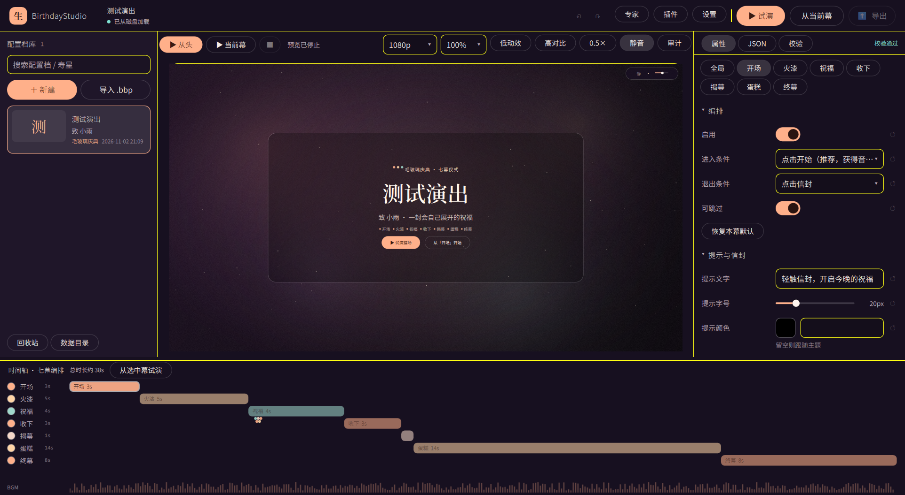
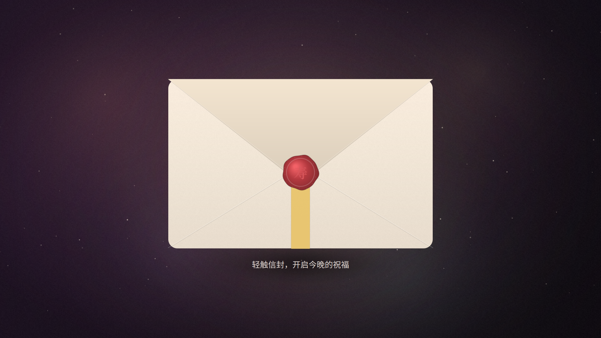
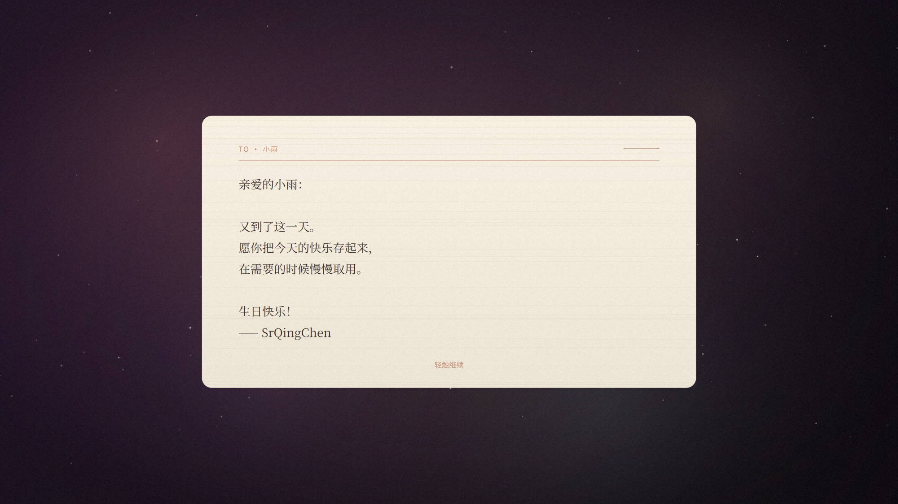
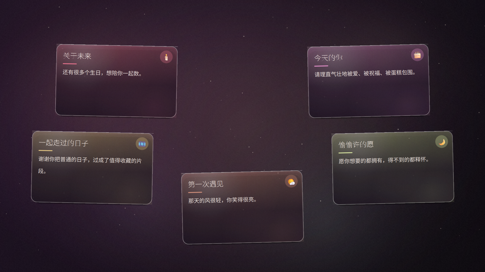
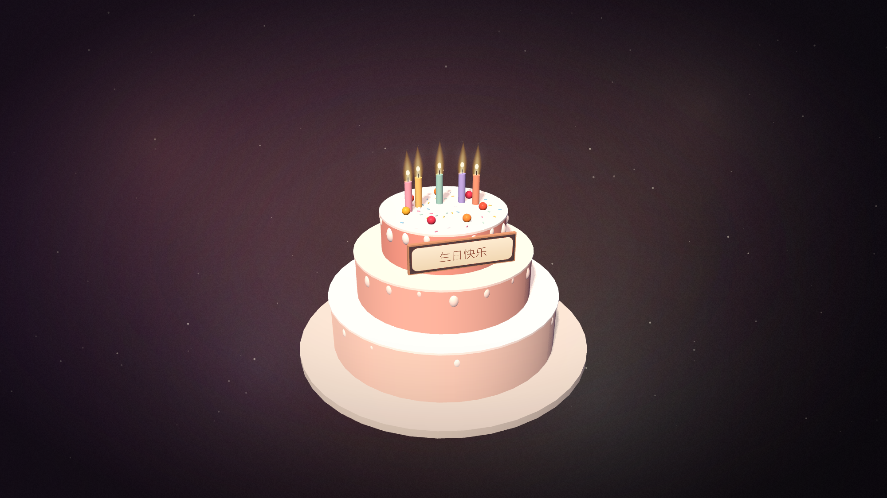
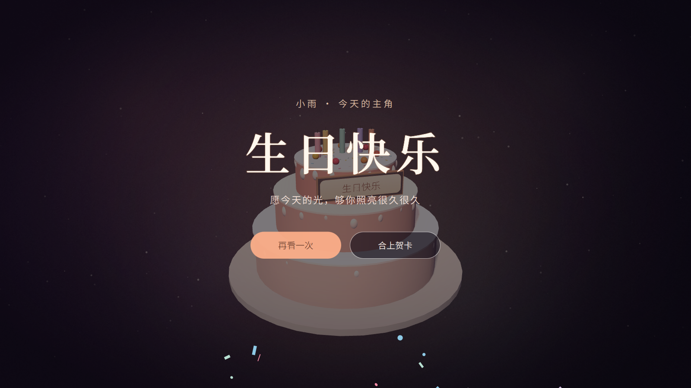
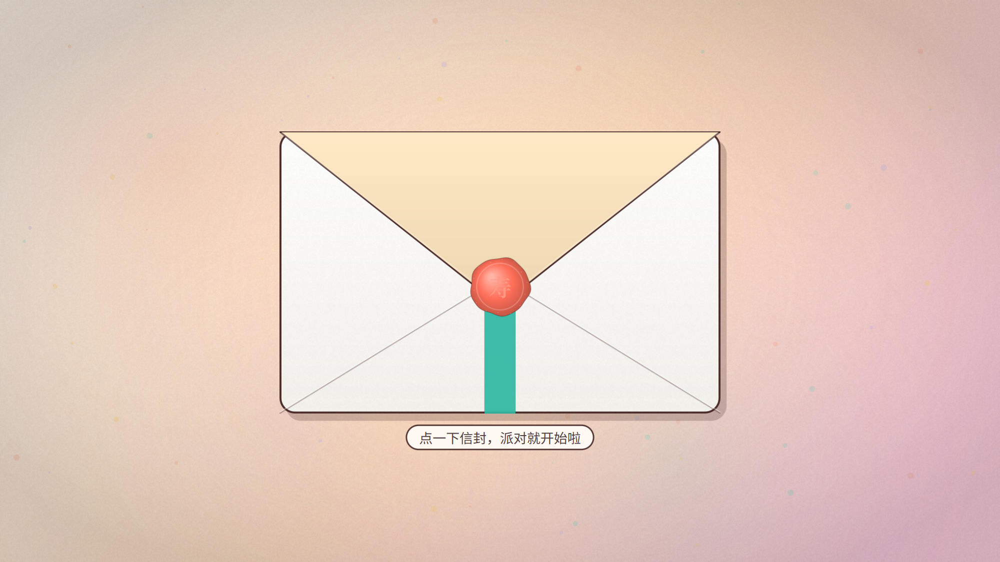

# BirthdayStudio · 生贺演出终端


> 把一句「生日快乐」，做成一场会自己展开的七幕仪式。

BirthdayStudio 是一个 **配置驱动的交互式生贺演出终端**，用 PySide6 + QML + Qt Quick 3D 构建。它有两个形态，共用同一套代码、同一套设计令牌、同一套渲染引擎：

- **编辑器（创作端）**：可视化编排七幕演出、实时预览、自动保存/崩溃恢复、配置档库、一键导出。
- **播放器（分发端）**：零配置的独立 exe + 配置包，在干净 Windows 电脑上完整演出。

作者：**SrQingChen** · 许可证：**GPL-3.0-or-later + GPLv3 §7 插件接口例外**



## 七幕仪式

```
幕1 开场      幕2 火漆       幕3 轨迹祝福     幕4 收下祝福    幕5 中心消融     幕6 蛋糕与许愿       幕7 终幕
音乐起+信封   点击火漆→信纸   弹窗沿轨迹飞出    中央确认+按压   纸面冻结后揭开3D   3D蛋糕+吹蜡烛→许愿    confetti+重播/合上
```

| 开场 | 信纸 | 轨迹弹窗 |
|---|---|---|
|  |  |  |

| 3D 蛋糕 | 终幕 | 卡通立体主题 |
|---|---|---|
|  |  |  |

## 功能一览

### 演出侧

- 七幕完整链路：火漆蓄力碎裂、信纸打字机/逐句浮现、轨迹弹窗（爱心/圆弧/环形/波浪/螺旋/手绘）、中心消融、3D 三层蛋糕、逐根吹蜡烛、许愿留白、终幕彩带与重播。
- 两套出厂主题：**毛玻璃庆典**（暖光/深酒红/玻璃卡片）与**卡通立体**（奶油底色/糖果色/厚底阴影）。
- 设计令牌驱动：圆角、毛玻璃、海拔阴影、动效时长/缓动、排版、目标尺寸、对比度、色彩角色、健康红线全部来自 `resources/design-tokens.json` 与主题 delta。
- 三条健康红线：闪烁 ≤3 次/秒且亮度变化 <10%；音频常驻可控、默认音量 ≤50%；低动效模式 + 系统减弱动态效果检测。
- 音频人因引擎：双 BGM 台 equal-power 交叉淡化、ducking、10–20ms 防爆音斜坡、音效/人声独立音量、常驻静音/暂停/音量条。
- 可选麦克风吹蜡烛（失败自动回退点击）。
- 运行时降级：缺资源静默跳过、视频/3D 失败回退、连续掉帧逐级降级。

### 编辑器侧

- 三栏 + 时间轴：配置档库 / 实时预览舞台 / 属性检查器 / 七幕泳道与音频波形。
- **预览即引擎**：预览使用的就是播放器同一套 `ShowStage`，零保真度损失。
- 配置档库：卡片/搜索/新建/复制/删除（30 天回收站）/`.bbp` 导入导出/快照历史。
- 数据安全三层防线：800ms 防抖自动保存 + 原子写 + journal 崩溃检测；5 分钟滚动快照保留 10 份。
- 崩溃恢复、重启自动恢复上次配置档与编辑上下文。
- 属性检查器 + JSON 源视图 + 校验中心；导出前错误门禁。
- 校验中心内置健康 lint：文字对比度、目标尺寸、音量、光敏参数、资源缺失、弹窗溢出。
- 时间轴：七幕泳道、时长估算、启用开关、弹窗序列点、播放头、BGM 波形。
- 轨迹绘制器：在画布上手绘一条线，立即作为弹窗轨迹。
- 五步向导（模板 → 写信 → 弹窗 → 蛋糕 → 预览导出）与专家模式。
- 资源导入：按内容 hash 去重、版权字段随资源记录、缺失资源标红。
- 插件管理：安装/启用/禁用/卸载、manifest semver 兼容门禁、健康 lint 同样适用。

### 导出与开源

- 默认导出：**通用播放器 + profile 目录 + 启动脚本** → zip（秒级）；也支持单文件 exe（需预构建，见下）。
- 导出包自动附带 `LICENSES/`（GPL-3.0 全文、第三方许可、源码获取说明）。
- 插件自动内嵌到导出包，收礼人零感知。
- 版本迁移框架：`schema_version` + 迁移器，旧版 `theme.json` 可导入。

## 快速开始

要求：Windows 10/11，Python 3.10+。

```bash
pip install -e .
python -m app                 # 打开编辑器
python -m app --play <配置>    # 直接演出（配置 id / profile 目录 / profile.json / .bbp）
```

也可以：

```bash
python launcher.py            # 与 python -m app 相同
python -m app --help
```

首次启动会进入五步向导（或「新建配置档」）。新建的配置档保存在 `%APPDATA%/BirthdayStudio/profiles/`。

### 构建播放器

```bat
scripts\build_player.bat
```

默认使用 PyInstaller onefile，生成 `dist\BirthdayStudioPlayer.exe`。设置 `USE_NUITKA=1` 可改用 Nuitka（体积更小，需要自行安装 Nuitka 与 C 编译器）。

本机已验证：PyInstaller 单文件 exe 约 **177 MiB（185 MB）**，可在无 Python 的干净环境中启动并完整演出（含 Qt Quick 3D）。Nuitka 的 ≤60 MB 目标是推荐发布路径，但需要在构建机安装工具链后验证。

导出包检测到 `dist\BirthdayStudioPlayer.exe` 时会自动复制并生成「启动演出.bat」；没有时生成开发模式启动器。

## 项目结构

```
app/
  main.py                 入口，--play 切换播放器
  config/                 Pydantic schema、迁移器、出厂主题模板
  core/                   profile 存储/自动保存/快照/journal、令牌、校验、音频、插件、导出
  backend/                QML 桥接：应用、会话、音频、插件、导出、麦克风
  qml/
    Main.qml / Player.qml / Editor.qml
    show/                 七幕演出引擎、3D 蛋糕、confetti、消融
    editor/               编辑器三栏、时间轴、预览、检查器
    components/           设计令牌驱动的 QML 组件
    overlays/             新建/导出/插件/设置/恢复/快照/回收站/向导/轨迹绘制
resources/
  design-tokens.json      设计令牌总表
  themes/                 毛玻璃庆典 / 卡通立体（tokens + template）
  audio/                  脚本合成的无版权 BGM 与音效
  textures/               火焰/烟雾/光斑/暗角/颗粒/消融遮罩
plugins/aurora-glass/     示例主题插件（PopupCard 槽位）
docs/                     规范、SDK、验收与分发文档
tests/                    核心契约、存储、校验、导出测试
scripts/                  构建、素材生成、预览截图、字体下载
```

## 文档

- [配置档 schema 与主题模板](docs/theme-schema.md)
- [编辑器交互与状态机](docs/editor-spec.md)
- [插件 SDK（八个稳定槽位）](docs/plugin-sdk.md)
- [性能预算与验收](docs/performance-budget.md)
- [导出与分发](docs/distribution-guide.md)
- [第三方依赖与许可](docs/THIRD-PARTY.md)
- [贡献政策（DCO）](CONTRIBUTING.md)

## 已知边界

- **单文件 exe** 选项当前会退回「播放器 + 配置包」形态；真正的 profile 内嵌单文件需要专用构建（策划案 X-02 为可选）。
- 插件槽位在宿主中以**视觉覆写**方式接入；插件不执行 Python，也不具备磁盘/网络权限。八个槽位的契约见 SDK 文档。
- **3D 后处理**：受测 Qt 6.11.1 + D3D11 环境下 `ExtendedSceneEnvironment` 会把场景渲染为黑色，因此当前用 plain `SceneEnvironment` + 发光火焰 sprite + 2D 光晕替代；3D 初始化失败会通过 Loader 回退到预渲染 2.5D 蛋糕。
- 自定义**视频背景**与**逐幕多段配乐**尚未在 schema 中暴露；当前支持主题渐变背景、内置音效与单条 BGM（音频引擎本身具备双台交叉淡化能力）。
- 无法使用 3D 的机器可设置 `BIRTHDAY_STUDIO_FORCE_2D=1` 强制使用 2.5D 预渲染蛋糕（吹蜡烛/许愿流程一致）。
- 内置字体目前使用系统回退（Windows 中文环境为微软雅黑/宋体）；`scripts/fetch_fonts.py` 可下载 OFL 字体到 `resources/fonts/`，打包时会自动注册。
- 时间轴目前提供可视化、单幕启用、双击试演与播放头；拖拽改时序仍以属性面板为准。
- PyInstaller onefile 实测约 177 MiB（185 MB）、启动 5–8s；Nuitka 的 ≤60MB 目标需在安装工具链后复测。

## 许可

本体以 **GPL-3.0-or-later** 发布，并附带 **GNU GPLv3 第 7 条附加许可——Stable Slots 插件接口例外**：通过稳定槽位 API 加载的主题插件是独立作品，可自由选择许可证（含闭源）。完整条款见 [LICENSE](LICENSE)。

导出包会包含 `LICENSES/GPL-3.0.txt`、第三方许可与源码获取说明。用户的祝福文字、图片、音乐与配置档归创作者所有，不因打包而变成 GPL 覆盖作品。

---

**BirthdayStudio 1.0.0** · 作者 [SrQingChen](https://github.com/SrQingChen) · 用一场仪式，认真地说一句生日快乐。
